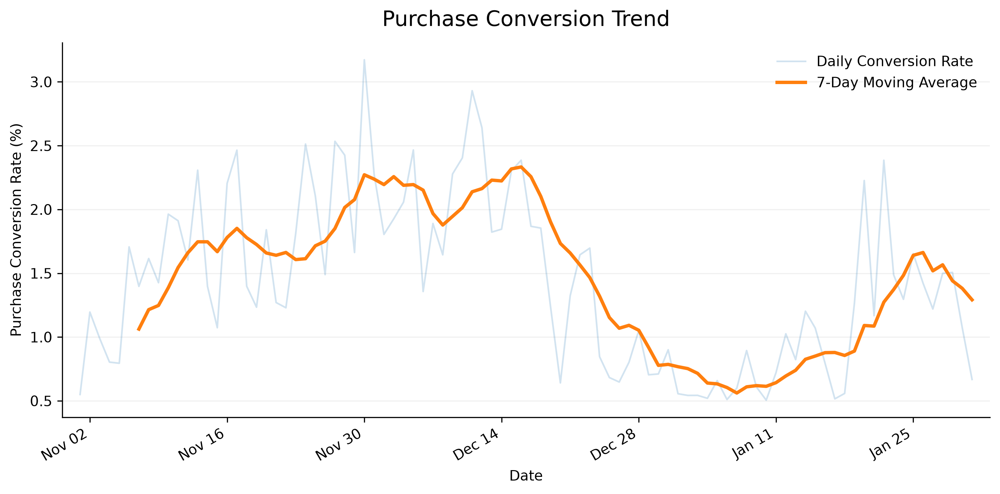
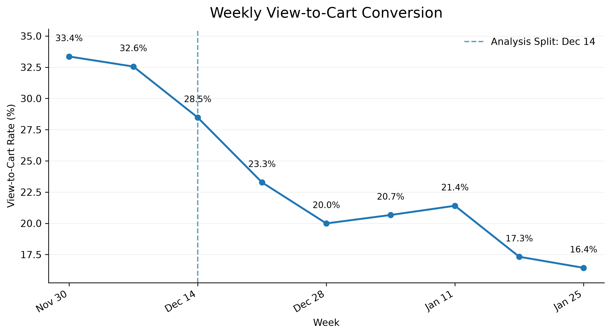
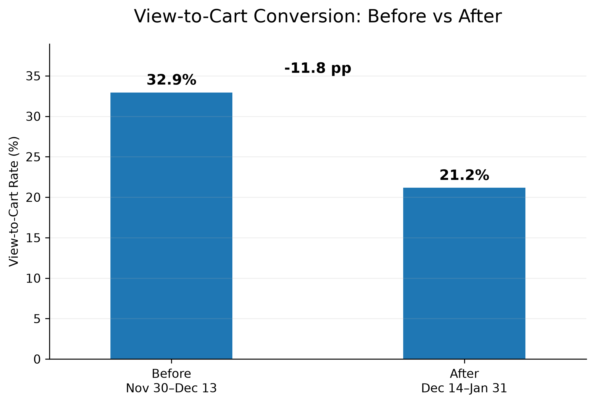

# GA4 E-commerce Conversion & Funnel Analysis

## Project Overview

This project analyzes the Google Merchandise Store GA4 public ecommerce dataset in BigQuery, covering November 2020 through January 2021.

The analysis focuses on changes in user traffic, purchase conversion, and the ecommerce funnel. SQL was used for data-quality validation, metric construction, funnel sequencing, and segment analysis, while Python was used for trend analysis and visualization.

The main diagnostic question was: **where did conversion deteriorate, when did the decline begin, and could it be explained by major traffic, device, or product segments?**


## Business Questions

1. How did traffic and purchase conversion change over the analysis period?
2. Which stage of the ecommerce funnel showed the largest deterioration?
3. When did the main funnel decline begin?
4. Could the decline be explained by device type, acquisition source, or a small number of top products?


## Dataset & Metric Definitions

**Source:** Google Analytics 4 obfuscated sample ecommerce dataset in Google BigQuery: `bigquery-public-data.ga4_obfuscated_sample_ecommerce`.

**Analysis period:** 2020-11-01 to 2021-01-31.

Key metrics used in the project include:

- **Daily Users:** distinct `user_pseudo_id` observed on each day.
- **Purchase Conversion Rate:** distinct purchasers divided by daily users.
- **Orders:** deduplicated purchase events.
- **View-to-Cart Rate:** users who performed `add_to_cart` after `view_item`, divided by users who performed `view_item`, calculated using a strict sequential funnel.
- **AOV:** known purchase revenue divided by orders with non-null revenue.


## Methodology

The analysis followed a diagnostic workflow:

1. **Validate data quality**
   - Investigated purchase-event duplication and transaction ID reliability.
   - Tested multiple time thresholds for purchase deduplication.
   - Assessed purchase revenue completeness and recoverability.
   - Checked event-level consistency for funnel tracking.

2. **Build reliable daily metrics**
   - Constructed daily users, purchasers, orders, purchase conversion, revenue, AOV, and revenue-missing metrics.

3. **Analyze overall trends**
   - Examined daily and monthly user traffic.
   - Used 7-day moving averages to separate short-term volatility from broader trends.
   - Checked weekday seasonality and purchase conversion changes.

4. **Diagnose the ecommerce funnel**
   - Built a strict sequential funnel:
     `view_item → add_to_cart → begin_checkout → purchase`.
   - Used daily and weekly analysis to identify the timing of the main deterioration.

5. **Narrow potential drivers**
   - Compared performance before and after the mid-December analysis split.
   - Tested whether the decline was concentrated by device, acquisition source/medium, or top products.


## Key Findings

1. **Data quality materially affects interpretation.** Purchase events contain probable duplicates, so a 1-second deduplication threshold was adopted after sensitivity testing. Across 0.1s, 1s, and 5s thresholds, orders and revenue varied by less than 0.4%, while AOV varied by less than 0.1%, indicating that the downstream metrics are robust to the exact threshold choice. Purchase revenue is also incomplete, particularly late in the sample period.

2. **Traffic alone does not explain the deterioration.** Daily users show clear weekday seasonality, while purchase conversion weakened substantially in the later part of the period.

3. **The main funnel weakness occurs at `view_item → add_to_cart`.** Later funnel stages did not deteriorate to the same extent, indicating that the largest loss occurred before checkout.

4. **The decline began around mid-December.** Weekly strict view-to-cart conversion fell from roughly 33% in early December to about 16% by late January.

5. **The before/after change was substantial.** Using 2020-12-14 as the analysis split, weighted view-to-cart conversion declined from approximately **32.9% to 21.2%**, a decrease of about **11.8 percentage points**.

6. **The deterioration was broad-based.** Desktop, mobile, and tablet all weakened, with view-to-cart conversion declining by approximately **11.6–13.6 percentage points** across device categories. Major acquisition source/medium groups also declined. Among the top 20 products, **17 (85%)** recorded lower view-to-cart conversion after the split, with a median change of approximately **-4.51 percentage points**.


## Visualizations

### Purchase Conversion Trend



Purchase conversion weakened in the later part of the analysis period, motivating a deeper funnel investigation.


### Weekly View-to-Cart Conversion



Weekly analysis shows that view-to-cart conversion began weakening around mid-December and continued declining into January.


### Before vs After



Using December 14 as the analysis split, weighted view-to-cart conversion decreased by approximately 11.8 percentage points.


## Data Quality & Limitations

Several data-quality issues affect interpretation:

- Some purchase events appear to be near-duplicate records. A 1-second rule was adopted after sensitivity testing; across 0.1s, 1s, and 5s thresholds, orders varied by 0.295%, revenue by 0.309%, and AOV by 0.031%.
- `transaction_id` is not a reliable global order identifier in this obfuscated sample.
- Purchase revenue contains missing values, especially late in January, and the missing revenue cannot be reliably recovered from item-level revenue.
- `add_to_cart` tracking is discontinuous during parts of November, so funnel interpretation was restricted to the more stable period beginning with the week of 2020-11-30.
- `traffic_source` represents acquisition-source information and should not be interpreted as current-session attribution.

The available dataset does not include sufficient information on promotions, price changes, inventory availability, site releases, merchandising changes, or experiments. Therefore, the analysis can **localize and narrow the conversion problem**, but it cannot identify a unique causal driver.


## Reproducibility

The CSV files in `data/` are derived outputs from the SQL analysis:

- `daily_metrics.csv` → `sql/02_daily_metrics.sql`
- `dedup_sensitivity.csv` → deduplication sensitivity section in `sql/01_data_quality.sql`
- `revenue_missing_by_date.csv` → revenue completeness section in `sql/01_data_quality.sql`
- `daily_funnel.csv` → daily strict view-to-cart section in `sql/03_funnel_analysis.sql`
- `weekly_funnel.csv` → weekly strict view-to-cart section in `sql/03_funnel_analysis.sql`

After generating the CSV outputs, run the Python scripts from the project root:

```bash
python python/01_trend_analysis.py
python python/02_funnel_trend.py
```


## Project Structure

```text
ga4-ecommerce-analysis/
│
├── README.md
├── .gitignore
├── requirements.txt
│
├── sql/
│   ├── 01_data_quality.sql
│   ├── 02_daily_metrics.sql
│   └── 03_funnel_analysis.sql
│
├── python/
│   ├── 01_trend_analysis.py
│   └── 02_funnel_trend.py
│
├── data/
│   ├── daily_metrics.csv
│   ├── daily_funnel.csv
│   ├── weekly_funnel.csv
│   ├── dedup_sensitivity.csv
│   └── revenue_missing_by_date.csv
│
└── images/
    ├── 01_users_trend.png
    ├── 02_conversion_trend.png
    ├── 03_view_to_cart_trend.png
    ├── 04_weekly_view_to_cart.png
    └── 05_view_to_cart_before_after.png
```


## Tools

- **BigQuery / SQL:** data-quality checks, metric construction, funnel analysis, and segmentation
- **Python:** pandas and matplotlib for trend analysis and visualization
- **GA4 ecommerce data:** event-level public sample dataset